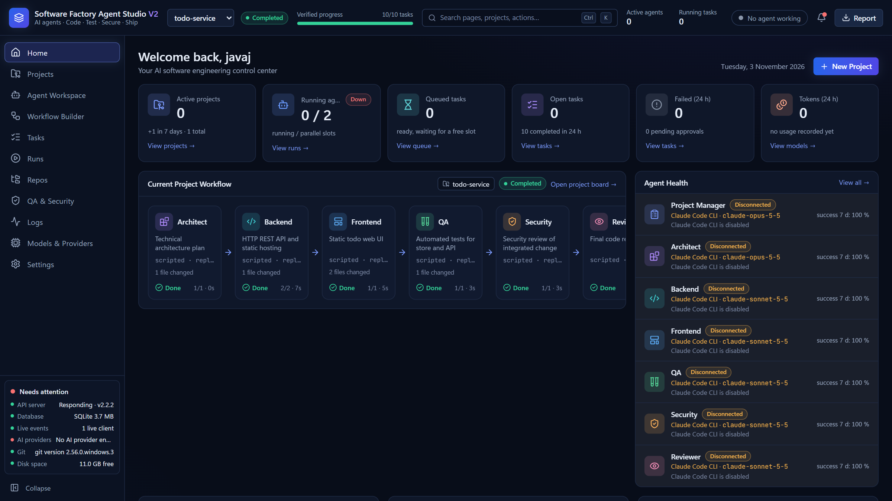
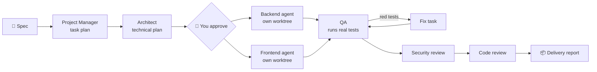
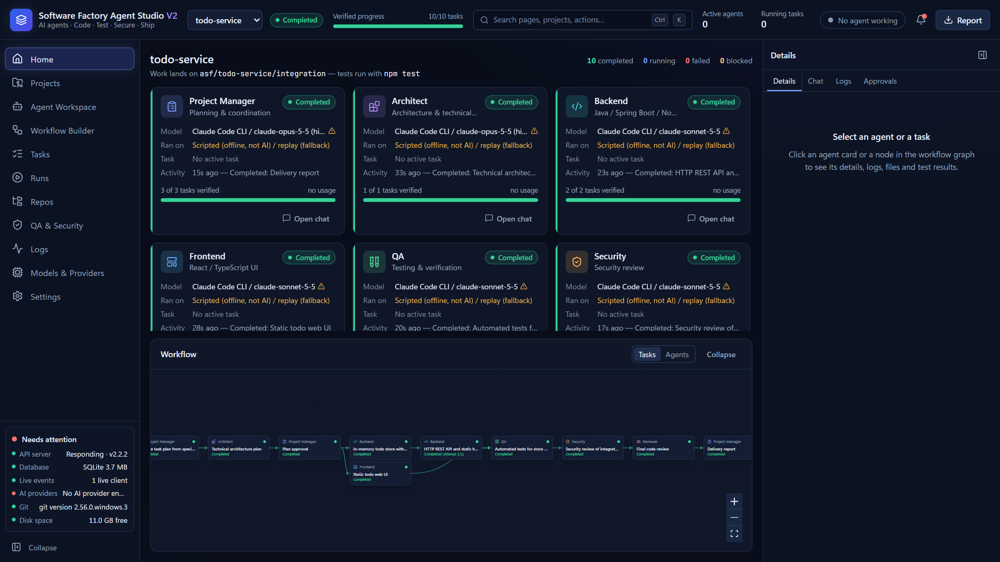
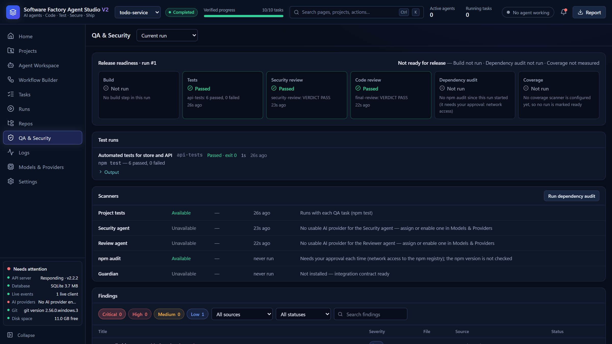
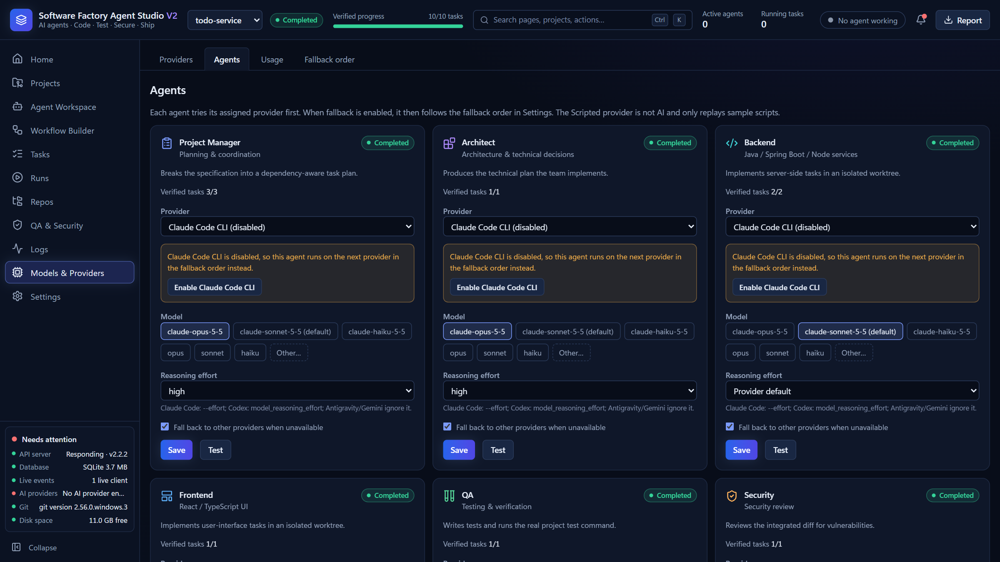
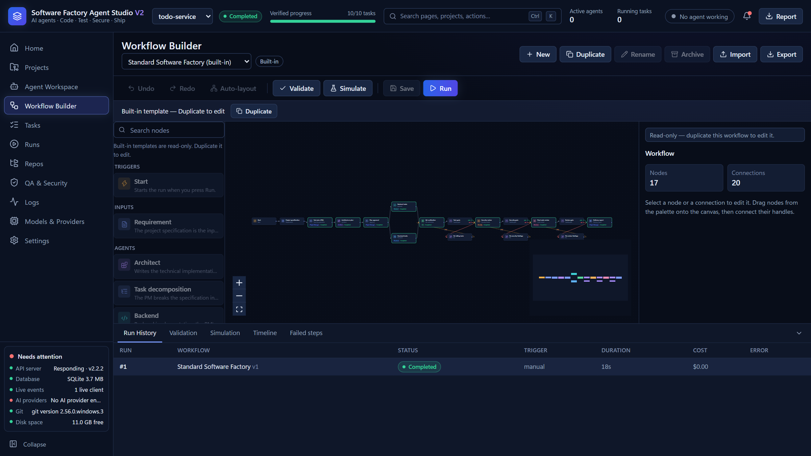

<div align="center">

# 🏭 AI Software Factory Studio

**Write a spec. Approve a plan. Watch a team of AI agents build, test, review and ship it.**

A local-first studio that turns one specification into working, tested code. It runs a full
software team of AI agents (PM, Architect, Backend, Frontend, QA, Security and Reviewer) in
parallel git worktrees. You stay in control of every decision.




</div>

---

## Why it exists

AI coding assistants are powerful, but one chat window is a single developer with no process.
Real software needs a plan, parallel work, tests that actually run, a security pass and a
review, and it needs proof of each step rather than a model saying "done".

**AI Software Factory Studio adds that process.** Every step is a real task with a real
outcome. Progress moves only on verified events: a commit merged, a test command that exits
with 0, a parsed `VERDICT: PASS`. The dashboard never shows simulated progress.

## What it does



1. **Plan:** the PM agent turns your spec into a dependency-aware task graph, which is validated as a DAG. The Architect writes the technical plan.
2. **Approve:** nothing is built until you approve the plan in the Approvals panel.
3. **Build in parallel:** Backend and Frontend agents work at the same time, each in its own git worktree. Merge conflicts are resolved by the agent that owns the task and checked for leftover markers.
4. **Verify for real:** QA writes tests and the studio runs your project's actual test command. Red tests create a fix task automatically, with a configurable number of rounds.
5. **Secure and review:** Security and Reviewer agents inspect the integrated diff and re-run the tests on the final code.
6. **Deliver:** you get a Markdown delivery report with every task, test run, verdict and finding.

## Screenshots

<table>
  <tr>
    <td width="50%"><br><b>Project board:</b> every agent, the model it really ran on, verified tasks and the live task graph.</td>
    <td width="50%"><br><b>QA &amp; Security:</b> release-readiness gate, real test runs, scanners and findings by severity.</td>
  </tr>
  <tr>
    <td width="50%"><br><b>Agents:</b> pick provider, model and reasoning effort per role; one-click live test of each agent.</td>
    <td width="50%"><br><b>Workflow Builder:</b> visual pipeline editor with validate, simulate and run history.</td>
  </tr>
</table>

## Features

**Multi-agent orchestration**
- 7 specialised agent roles, each with its own provider, model, reasoning effort and fallback setting.
- A DAG scheduler with parallel slots, retries, checkpoints, pause, resume and cancel.
- Crash recovery: interrupted work is committed as `wip(<task>)` and the next attempt continues from it instead of starting over.
- Visual **Workflow Builder**: duplicate the standard pipeline, edit nodes, validate, simulate and run.
- **Multi-Agent Workspace**: live agent terminal sessions side by side.

**Works with the AI you already pay for**
- **Claude Code CLI**, with automatic discovery of several Claude logins.
- **OpenAI Codex CLI**.
- **Antigravity** and **Gemini CLI**.
- Any **OpenAI-compatible HTTP** endpoint.
- **Usage-limit failover:** when a provider replies "limit reached, resets at 9:20 pm", it is parked until that time and the same turn continues on the next provider within seconds.
- The model the CLI *really* used is recorded. A silent downgrade (asked for Opus, got Sonnet) is shown, not hidden.
- An offline **Scripted** provider replays a sample project end to end, so you can try everything with zero AI quota.

**Live visibility**
- Real-time dashboard over Server-Sent Events with replay on reconnect.
- **Live monitor**: every running agent, its current file ("Editing `src/server.ts`"), elapsed time, attempt and provider.
- Per-provider usage, token counts and the full event log for each project.

**Security by design**
- Binds to `127.0.0.1` only. A token is required for any non-loopback access, and a Host allowlist defends against DNS rebinding.
- CSRF origin check and a JSON content-type guard on every mutating request.
- A path guard that follows junctions and symlinks. Protected folders (home configs, AppData, system folders) can never be imported.
- A git subcommand allowlist: the studio **never** pushes, resets, cleans or deletes your branches. Your checkout is never touched; work lands on `asf/<project>/*` branches.
- Shell commands are allowlisted and parsed to argv with no shell metacharacters. Anything else needs your approval.
- `.env` and key files are never served, copied or committed, every API response is redacted, and repository hooks cannot run during agent work.

## Quick start

**Requirements:** Node.js 22.13+ and git. AI CLIs are optional and detected automatically.

```bash
git clone https://github.com/nodirbek9/-ai-software-factory-studio.git
cd -ai-software-factory-studio
npm install
npm start            # builds the UI and serves everything on http://127.0.0.1:4317
```

On Windows you can also double-click `start-studio.cmd`.

For development with hot reload, run `npm run dev` (API on :4317, Vite UI on http://127.0.0.1:5317).

### Your first run: 2 minutes, no AI quota

1. **Projects → New project → Sample project → `todo-service` → Create**.
2. Top bar → **Generate plan**. The PM and the Architect run, and the plan waits in **Approvals**.
3. **Approve**. Backend and Frontend run in parallel worktrees. The `http-api` task fails once on purpose and is retried. QA runs `npm test` for real, Security and the Reviewer give their verdicts, and the **Report** is generated.

To let real models do the work: **Models & Providers → enable Claude Code CLI** (or another provider) **→ Agents → assign it**.

### Configuration

Copy `.env.example` to `.env`. The main options:

| Variable | Default | Purpose |
|---|---|---|
| `ASF_PORT` | `4317` | API and UI port |
| `ASF_HOST` | `127.0.0.1` | Bind address; a non-loopback address requires `ASF_AUTH_TOKEN` |
| `ASF_DATA_DIR` | `./data` | SQLite database, workspaces and worktrees |
| `ASF_APPROVED_ROOTS` | none | Folders you allow repositories to be imported from |
| `ASF_OPENAI_BASE_URL` / `ASF_OPENAI_API_KEY` | none | Optional OpenAI-compatible provider |

## Architecture

```
Browser (React 19 + Vite + Tailwind 4 + React Flow + Zustand)
   ▲ SSE /api/events (Last-Event-ID replay)      ▼ REST /api/* (zod-validated)
Fastify 5 server (single Node.js process)
   ProjectService → TaskScheduler → AgentExecutor → ProviderRegistry (Claude / Codex / Gemini / HTTP / Scripted)
        │                 │
   ApprovalService   WorkspaceManager (git worktrees, path guard, command runner)
        ▼
   node:sqlite (WAL) ◄── EventStream (persist + broadcast)
```

| Decision | Choice | Why |
|---|---|---|
| Runtime | One Node.js process, TypeScript via `tsx` | A local tool needs no microservices |
| Storage | Built-in `node:sqlite` (WAL) | No native build step on Windows; transactional; a single file |
| Isolation | One git worktree per task, merged into an integration branch | Parallel tasks never share a working tree |
| Live updates | SSE with persisted event ids | Replay on reconnect; nothing is lost |
| Progress | Only verified events | The dashboard never lies |

More detail: [docs/ARCHITECTURE.md](docs/ARCHITECTURE.md) and the V2 design docs in [docs/v2/](docs/v2/).

## Quality

```bash
npm test             # server: unit, API, hardening and end-to-end workflow tests; web: component tests
npm run typecheck
npm run test:e2e     # Playwright browser tests against a fresh, isolated studio
```

- **766 automated tests** across the server and the web UI, including 15 dedicated security-hardening regression tests.
- Browser end-to-end tests (Playwright) run on a temporary data directory with the offline provider, so they cost nothing and never touch your data.
- Verified live with real models: Claude Code planned, built and tested a new spec end to end (**14 tests passed, 0 failed**, in 121 s).

## Tech stack

**Server:** Node.js · TypeScript · Fastify 5 · `node:sqlite` · zod · node-pty · Vitest
**Web:** React 19 · Vite · Tailwind CSS 4 · React Flow · Zustand · xterm.js · Vitest + Testing Library
**Testing:** Vitest · Playwright (Microsoft Edge)

## Author

Built by **[Nodirbek](https://github.com/nodirbek9)**. I build AI-agent tooling, developer
platforms and full-stack systems (Java/Spring Boot, TypeScript/React).

Interested in a custom version, a team setup or a demo? Open an issue or contact me through
GitHub.
